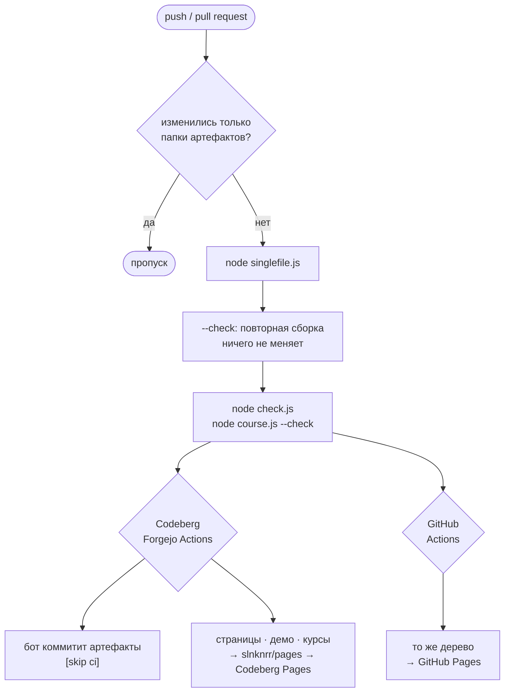

# README для DevOps

Как репозиторий собирает свои артефакты, как его запускать и проверять и как CI его публикует.

Инструментарий — самописная цепочка без зависимостей в корне репозитория: парсер ECMAScript 2024, анализ областей
видимости, бандлер с tree-shaking, минификаторы HTML, CSS и JS и сборщик, который превращает каждое приложение в
артефакты, запрошенные его NOTICE-файлами. Это обычный Node.js ≥ 22.12 или Bun (CI использует Node 24). Устанавливать
нечего: ни `package.json`, ни `node_modules`.

> У родственного репозитория [in-javascript](https://codeberg.org/slnknrr/in-javascript) своя цепочка,
> `downgrade.js`, которая понижает сниппеты до ES3 … ES2025. Здесь задача другая: цель — браузер, а единица —
> приложение.

---

## Быстрый старт

```bash
node singlefile.js
```

```bash
node check.js
```

Первая команда собирает каждое приложение. Вторая запускает все проверки без браузера. Запускайте обе перед коммитом.

| команда | что делает |
| --- | --- |
| `node singlefile.js [app …]` | собрать артефакты каждого приложения или только названных |
| `node singlefile.js --check` | собрать в памяти и выйти с кодом 1, если артефакт отсутствует или устарел; ничего не пишет |
| `node singlefile.js --publish <dir>` | ещё и записать однофайловые страницы под их публикационными именами (`LANDING.html`, …) |
| `node singlefile.js --target demo --demo <dir>` | собрать офлайн однофайловые демо (`DEMO_NOTICE.md`) в `<dir>` |
| `node server.js [port] [--api]` | сервер разработки для исходников, по желанию с JSON API-заглушкой в памяти |
| `node check.js` | связи модулей + модульные тесты библиотек + сетевой аудит + проверки Electron |
| `node check.js page <url\|file>` | открыть страницу в headless Chrome: ошибки консоли, `--eval`, `--shot` |
| `node check.js e2e <url\|file> <scenario.js>` | выполнить сквозной сценарий внутри страницы |
| `node check.js golden <app> <outDir>` | детерминированные экспорты каждого шаблона, чтобы доказать, что рефакторинг ничего не изменил |
| `node course.js --fix` · `--check` · `--out <dir>` | сопровождать и собирать учебные курсы |

Флаги `singlefile.js`: `--target singlefile | files | demo`, `--no-minify`, `--check`, `--quiet`,
`--publish <dir>`, `--demo <dir>`. Каждый скрипт печатает справку из своего заголовочного комментария.

## Что такое приложение

**Каталог верхнего уровня, в имени которого есть `-`**, — приложение (`resume-app/`, `kdbx-app/`, `site-studio/`).
Каталог без `-` — общая библиотека (`ui/`, `doc/`, `png/`, `zip/`, …). Каталоги с точкой (`.t9n/`, `.@foofe/`) и
**каталоги артефактов** (глубина 2, в имени есть `@`) никогда не читаются как исходники. Приложения импортируют
библиотеки по путям `../`, поэтому исходники работают несобранными прямо из корня репозитория. Убирает `../` именно
сборка.

## Артефакты и NOTICE-файлы

Без NOTICE-файлов приложение получает два артефакта по умолчанию:

| артефакт | содержимое |
| --- | --- |
| `<app>/html@5-singlefile/<page>.html` | по одному самодостаточному, очищенному tree-shaking, минифицированному файлу на страницу; открывается из `file://` |
| `<app>/html@5/` | многофайловая копия: страницы, модули приложения и используемые ими модули библиотек подпапками, каждый очищен отдельно |

Когда в приложении есть NOTICE-файлы, оно получает **ровно** те артефакты, которые они называют. Наличие файла и есть
запрос, а сам notice заодно документирует, что обещает артефакт (`targets.js`):

| NOTICE-файл | артефакт |
| --- | --- |
| `OFFLINE_NOTICE.md` | `html@5_offline/`: многофайловый, ноль сети |
| `SINGLEFILE_OFFLINE_NOTICE.md` | `html@5_offline_singlefile/<page>.html`: по файлу на страницу, ноль сети |
| `SERVERLESS_NOTICE.md` | `html@5_serverless/`: статический сайт для любого статического хостинга, с маршрутизацией через `404.html` |
| `SINGLEFILE_SERVERLESS_NOTICE.md` | `html@5_serverless_singlefile/<app>.mjs`: один скрипт, который отдаёт сайт как GitHub Pages |
| `BACKEND_NOTICE.md` | `html@5_backend/`: `server.mjs` + `backend.mjs` + `public/` |
| `SINGLEFILE_BACKEND_NOTICE.md` | `html@5_backend_singlefile/<app>.mjs`: сервер, бэкенд и страницы в одном скрипте |
| `STANDALONE_NOTICE.md` | `html@5_standalone/<page>.html`: открывается из `file://`, общается с серверами по HTTPS + CORS |
| `ELECTRON_NOTICE.md` | `html@5_electron/`: настольное приложение для Electron ≥ 29 |
| `SINGLEFILE_ELECTRON_NOTICE.md` | `html@5_electron_singlefile/`: то же, но бэкенд и страницы внутри `main.mjs` |
| `DEMO_NOTICE.md` | не коммитится; CI собирает его в `demo/<slug>.html` на Pages (`# RESUME BUILDER` → `resume-builder.html`) |

`SINGLEFILE` может стоять по любую сторону имени. Если он стоит с обеих сторон — это ошибка. Неизвестные имена
игнорируются, а `check.js` сообщает об отсутствующем артефакте. Папки артефактов, которые больше не запрошены ни одним
notice, удаляются.

Каждая страница узнаёт свой артефакт из `globalThis.IN_HTML_ARTIFACT = { mode, singlefile, servers }`. В
офлайн-артефактах импорт `./x.js` разрешается в `./x.offline.js`, если такой двойник существует, поэтому сетевого кода в
них нет вовсе.

## Конвейер

```mermaid
flowchart LR
  html["page.html"] --> tok["tokenizeHTML<br/>поток токенов, а не DOM"]
  tok --> entries["модульные скрипты → точки входа<br/>CSS · картинки · шрифты → встраиваются"]
  entries --> parse["parse.js<br/>ES2024 → ESTree"]
  parse --> scope["scope.js<br/>привязки · глобальные"]
  scope --> bundle["bundle.js<br/>порядок вычисления · единицы<br/>живость · переименование"]
  bundle --> finish["finishJS<br/>повторная токенизация · минификация<br/>экранирование &lt;/script"]
  finish --> links["ссылки на соседние страницы<br/>→ целевые имена"]
  links --> audit{"policy.js<br/>сетевой аудит"}
  audit -- offline + сеть --> fail(["сборка падает"])
  audit --> out["артефакты html@5*/"]
```



| файл | роль |
| --- | --- |
| `singlefile.js` | сборка: страницы → артефакты, `--check`, `--publish`, демо |
| `targets.js` | NOTICE-файлы → план артефактов; пишет серверы и папки Electron |
| `multifile.js` | многофайловая копия: режим разделения бандлера, по одному очищенному модулю на исходник |
| `bundle.js` | бандлер ES-модулей: scope hoisting и tree-shaking с учётом побочных эффектов; офлайн-варианты; ресурсы `?bundle` |
| `parse.js` | парсер ECMAScript 2024, ESTree в том виде, как его выдаёт acorn, с потоком токенов |
| `scope.js` | анализ областей видимости для живости в бандлере и переименования без коллизий |
| `minify/` | минификаторы HTML, CSS и JS, работающие на потоках токенов |
| `policy.js` | классы приложений и текстовый сетевой аудит **итогового** артефакта |
| `hosting.js` | сервер внутри генерируемых артефактов (Node ≥ 18, только модули `node:`, копируется как есть) |
| `electron.js` · `electron-preload.cjs` | главный процесс и preload Electron-артефактов |
| `server.js` | сервер разработки для исходников (+ заглушка `/api`) |
| `mime.js` | одна таблица медиатипов для сервера разработки и сборщика |
| `check.js` · `check-electron.js` · `check-editor.js` | проверки: модули, тесты, аудит, Electron, headless-браузер, e2e |
| `course.js` | `LEARN_*_COURSE.md` → страницы курсов с живыми примерами |

Ключевые решения вкратце:

- **Разметка пересобирается из токенов, а не из DOM.** Необязательные теги автора, порядок атрибутов и пробелы в
  `<pre>` переживают сборку.
- **Вывод склеивается из исходного текста,** а не печатается из AST, поэтому каждый литерал остаётся ровно таким, как
  написан.
- **Сетевой аудит читает собранные байты,** а не исходники. Исходники лгут умолчанием: собранный помощник может принести
  сетевой код, которого никто не писал в приложении. Ложное срабатывание громкое и дёшево исправляется, а ложный
  пропуск молча нарушил бы обещание «работает офлайн».
- **У генерируемых серверов ноль зависимостей,** и по умолчанию они слушают `127.0.0.1`, так что артефакт и через годы
  запустится голым `node`.

## Генерируемые серверы и настольные сборки

Цели BACKEND нужен `<app>/backend.js`, экспорт по умолчанию которого — `(ctx) => ({ handle(req, res, url) })`. Бэкенд
обращается к Node через `ctx.node` (http, fs, crypto, child_process, …) и никогда через импорты, потому что бандлер
разрешает только относительные файлы. Его хранилище — `ctx.storage`, а `ctx.mode` говорит, работает ли он как
`backend`, `electron` или `dev`.

```bash
node html@5_backend_singlefile/<app>.mjs 8080 --host 0.0.0.0 --data ./data
```

Порт по умолчанию 8080 (или следующий свободный, если он занят), хост — `127.0.0.1`, папка данных — `./data`. Те же
настройки можно задать через `PORT`, `HOST` и `DATA_DIR`.

Electron-артефакты отдают страницы из привилегированной схемы `in-html://<app>/`, не открывая TCP-порт. Окна работают с
изоляцией контекста и включённой песочницей, без интеграции Node. CSP перечисляет SHA-256-хеши встроенных скриптов.
`<app>/electron.json` настраивает окно, мини-плеер, белый список внешних ссылок и CSP. Пользователи запускают
приложение командой `npx electron .` в папке артефакта. `node check.js electron` проверяет артефакты под заглушкой
модуля `electron`, так что CI не нужны ни бинарник, ни дисплей.

## Проверки

`node check.js` работает без браузера и завершается с кодом 0 или 1:

- **modules**: импортирует в Node каждый модуль библиотек и приложений, чтобы всплыли ошибки связывания
  (отсутствующие экспорты, синтаксис). Сбои, возможные только в браузере, пропускаются.
- **tests**: `<lib>/test.js` экспортирует `run()` и возвращает свои сбои.
- **audit**: сетевая политика каждого собранного артефакта.
- **electron**: схема, безопасность окна, CSP, IPC и preload Electron-артефактов.

Браузерные команды (`page`, `e2e`, `golden`) управляют локальным Chrome, Chromium или Edge через протокол DevTools по
встроенному в Node WebSocket, без Puppeteer и без скачивания. `CHROME=<path>` переопределяет поиск.

## Курсы

`LEARN_*_COURSE.md` на верхнем уровне и в `.t9n/<lang>/` — обычный GFM, который хорошо читается на Codeberg.
`course.js` публикует каждый как `course/in-html/<slug>.html` (или `<lang>/course/in-html/…`). Каждый пример внутри
блока `<details>` с ограждением ```` ```html ```` становится отдельным документом `<slug>/example-<n>.html`, который
показывается вживую через `<object>`. Нумерация примеров позиционная, поэтому после добавления или перестановки
примеров запускайте `node course.js --fix`. CI запускает `--check`.

Русские курсы начинаются с оглавления
[.t9n/ru/LEARN_COURSE.md](https://codeberg.org/slnknrr/in-html/src/branch/all-in-one/.t9n/ru/LEARN_COURSE.md).

## CI

Два workflow выполняют один конвейер: один на источнике, другой на зеркале:



| | [.forgejo/workflows/html5.yml](https://codeberg.org/slnknrr/in-html/src/branch/all-in-one/.forgejo/workflows/html5.yml) | [.github/workflows/html5.yml](https://codeberg.org/slnknrr/in-html/src/branch/all-in-one/.github/workflows/html5.yml) |
| --- | --- | --- |
| где выполняется | Codeberg, `codeberg-tiny`, `node:24-bookworm` | GitHub, `ubuntu-latest`, `node:24-bookworm` |
| сборка, воспроизводимость, проверки, курсы | да | да |
| коммитит артефакты обратно | да, как `html@5 bot`, `[skip ci]` | нет: зеркало никогда не пишет, поэтому не может разойтись с источником |
| публикует | в репозиторий Pages `slnknrr/pages` → Codeberg Pages | как Pages-артефакт → GitHub Pages |
| защита от зацикливания | `paths-ignore` + проверка по `git diff` | `paths-ignore` |

Поведение на pull request одинаково с обеих сторон. Устаревшие артефакты лишь попадают в отчёт и пересобираются после
слияния.

**Настройка Codeberg.** Включите Actions в настройках репозитория. Обратный push использует автоматический токен;
задайте секрет `CI_TOKEN`, если репозиторий ограничивает этот токен. Для публикации нужен секрет `PAGES_TOKEN` — токен с
правом записи в репозиторий Pages. Переменные `PAGES_REPO` (по умолчанию `slnknrr/pages`) и `PAGES_BRANCH` (по
умолчанию `main`) выбирают цель. Без `PAGES_TOKEN` задача публикации только собирает и перечисляет страницы.

**Настройка GitHub.** Settings → Pages → Source: GitHub Actions. Секреты не нужны.

Страницы курсов ссылаются в превью на `https://slnknrr.codeberg.page/` (`PAGES` в `course.js`), поэтому копия на GitHub
Pages ведёт за живыми примерами обратно на Codeberg Pages.
