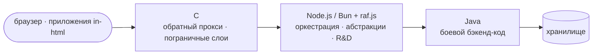

# Резюме веб-разработчика

[← in-html](https://codeberg.org/slnknrr/in-html/src/branch/all-in-one/.t9n/ru/README.md)
· [slnknrr →](https://codeberg.org/slnknrr/.profile/src/branch/about/)

## Профиль

Веб-разработчик с упором на JavaScript, бэкенд-разработку и инженерию сопровождаемых программных систем. В работу входят создание переиспользуемых библиотек, разработка серверной функциональности, структурирование кодовых баз, автоматизация процессов разработки и документирование технических решений.

Интересуюсь практичными веб-приложениями, архитектурой бэкенда, производительностью и решениями с минимумом зависимостей. Предпочитаю явный поток данных, небольшие переиспользуемые компоненты и сопровождаемые реализации лишним абстракциям.

## Направление

Стек, к которому сходятся мои исследования, — каждый язык в том слое, где он лучше всего:

- **Java**: боевой бэкенд, где важно, чтобы код был типизирован, долговечен и сопровождался командой.
- **Node.js / Bun с raf.js** (моя собственная библиотека): оркестратор и место для абстракций и R&D, где идеи
  доказываются, прежде чем их закаляют.
- **C**: обратный прокси и подобные тонкие слои рядом с сетью, где на счету каждое выделение памяти и системный вызов.

Это естественное продолжение моей текущей работы, а не смена направления. in-javascript уже исследует, во что обходится
среда выполнения, а in-html уже поставляет собственные серверы.

## Технические навыки

- **Языки:** JavaScript, HTML, CSS; рабочее знание C и Java.
- **Среда выполнения и бэкенд:** Node.js, Bun; серверная разработка, обработка запросов, сетевое взаимодействие и архитектура бэкенда.
- **Веб-разработка:** модульное проектирование приложений, переиспользуемые компоненты, клиент-серверное взаимодействие, структура приложений и веб-развёртывание.
- **Данные и хранение:** SQLite, работа с двоичными данными, структуры данных и сериализация.
- **Библиотеки и пакеты:** проектирование переиспользуемых JavaScript-библиотек, npm-пакеты, публичные API и реализации с минимумом зависимостей.
- **Браузерная платформа:** Web Crypto, IndexedDB, Service Workers, WebGL, Canvas, API медиа и камеры, File API, печать в истинном размере.
- **Процесс разработки:** Git, Forgejo Actions и GitHub Actions, воспроизводимые сборки, Codeberg Pages и GitHub Pages, тесты в headless-браузере, совместимость между версиями.
- **Документация:** технические спецификации, README-файлы, документация API, соглашения разработки и архитектурные заметки.
- **Производительность и безопасность:** программирование с вниманием к выделениям памяти, поведение среды выполнения, основы протоколов и инженерия с упором на безопасность.

## Избранные проекты

### batume.li — веб-портал

Разработка концепции веб-портала для Грузии, объединяющего местные сервисы и единую среду приложений.

- Бэкенд-разработка на Bun и SQLite.
- Планирование структуры приложения и серверной функциональности.
- Исследование централизованной аутентификации и доступа к сервисам на основе OAuth.
- Работа с данными OpenStreetMap и отрисовкой карт в браузере.
- Учёт требований к локализации, развёртыванию и инфраструктуре.

**Технологии:** JavaScript, Bun, SQLite, OAuth, OpenStreetMap, MapLibre, Leaflet.

*Ход разработки проекта и объём реализации следует описывать по текущему состоянию кодовой базы.*

### in-html — веб-приложения frontend-first

[codeberg.org/slnknrr/in-html](https://codeberg.org/slnknrr/in-html): портфолио из более чем 45 веб-приложений на
примерно 90 собственных библиотеках. Ни npm-зависимостей, ни CDN, ни фреймворка. Каждое приложение — обычные
ES-модули, которые открываются в браузере как есть.

- **Настоящие продукты, а не демо.** В наборе — совместимый с KeePass менеджер паролей (KDBX 3.1/4), кошельки Bitcoin
  и Ethereum с PSBT и подписью с воздушным зазором, таблицы со 190 функциями формул, многослойный редактор изображений
  и видеоредактор, показывающие каждую правку командой ImageMagick или ffmpeg, и архивный коммандер для ZIP, 7z, tar и
  zst. Есть также чтение и запись EPUB/FB2, конструктор сайтов с 36 шаблонами, студия вышивки крестом, САПР лекал
  одежды с 3D-симуляцией ткани и движки правил с ботами для дурака, морского боя и судоку.
- **Сложная браузерная инженерия.** Всё это работает внутри браузера: кодеки PNG, JPEG, WebM, MP4, MP3 и OGG;
  запись deflate, LZMA2 и Zstandard; хранилища на Web Crypto; WebGL и программный 3D; IndexedDB; Service Workers;
  камера и сканирование штрихкодов; печать в истинном размере в мм.
- **Один исходник — много поставок.** `singlefile.js` собирает каждое приложение в один самодостаточный HTML-файл на
  страницу и в многофайловую статическую копию. NOTICE-файлы могут запросить больше: offline (ноль сети), serverless
  (статический хостинг с маршрутизацией через `404.html`), backend (сервер на Node ≥ 18), standalone или Electron.
- **Архитектура как политика.** Классы приложений идут от client через SPA, PWA и *isomorphic* (находит центральный
  API, иначе обнаруживает локальную инфраструктуру) до standalone. Сборка их соблюдает: артефакт, объявленный
  офлайновым, валит сборку, если содержит хоть какой-то сетевой API.
- **CI/CD.** Forgejo Actions на Codeberg и GitHub Actions на зеркале выполняют один конвейер. Они собирают,
  доказывают воспроизводимость вывода (повторная сборка ничего не меняет), запускают проверки связей модулей, модульные
  тесты и проверки сетевой политики, а также сквозные и golden-тесты в headless-браузере. Однофайловые страницы,
  офлайн-демо и генерируемые курсы публикуются на Codeberg Pages и GitHub Pages.
- **Осознанный стиль.** JavaScript здесь простой, программный и умеренный: код, по которому читатель пройдёт от
  обработчика события до DOM. Выразительный, модульный, метапрограммный JavaScript живёт в in-javascript.

**Фокус:** HTML, CSS, браузерный JavaScript, двоичные форматы в браузере, offline-first и unhosted-приложения,
инструменты сборки, статическое развёртывание.

### in-javascript — R&D-лаборатория JavaScript

[codeberg.org/slnknrr/in-javascript](https://codeberg.org/slnknrr/in-javascript): языковая сторона той же работы.
Здесь — порты и оригинальные реализации структур данных и алгоритмов, написанные сначала наивно, затем канонически,
затем в других парадигмах. Бэкенд-код появляется там в виде основ и компонентов.

- `downgrade.js`: самописный компилятор и бандлер без зависимостей (около 10 000 строк). Он понижает ES2025+ до ES3
  и Node 4–24, а CI загружает артефакты на этих настоящих движках.
- Репозиторий разбит на маленькие модули с одной ролью, переиспользующие друг друга, плюс исполняемые разборы, которые
  служат и тестами.

**Подробнее:** [JAVASCRIPT_CV.md](https://codeberg.org/slnknrr/in-javascript/src/branch/all-in-one/JAVASCRIPT_CV.md).

### JavaScript-библиотеки и npm-пакеты

Разработка и публикация переиспользуемых JavaScript-пакетов в пространстве имён `@slnknrr`.

- Проектирование небольших сфокусированных API и переиспользуемых примитивов.
- Реализация решений с минимумом зависимостей и явным поведением.
- Работа с двоичными данными, побитовыми операциями и генерацией случайных значений.
- Сопровождение документации пакетов и репозиториев исходников.

**Поиск пакетов:** https://nichedb.dev/search?q=%40slnknrr  
**Профиль npm:** https://www.npmjs.com/~slnknrr

## Дополнительный ИТ-опыт

### ИТ-поддержка и системное администрирование

Опыт работы в ИТ-отделе КПЭУ, Краснодар, во время учёбы.

- Поддержка компьютерного оборудования и ПО.
- Администрирование и настройка Windows.
- Задачи с PowerShell, реестром и Active Directory.
- Резервное копирование и управление общими ресурсами.
- Устранение технических неполадок и выявление эксплуатационных проблем.

## Инженерный подход

- Предпочитаю небольшие компонуемые решения с чётко определённой ответственностью.
- Обращаю внимание на поведение во время выполнения, расход ресурсов и совместимость.
- Отношусь к документации и соглашениям разработки как к части кодовой базы.
- Использую автоматизацию, чтобы сборки и сопровождение были единообразнее.
- Оцениваю архитектуру по практическим требованиям, а не по сложности ради сложности.

## Публичная работа

**Codeberg:** https://codeberg.org/slnknrr  
**GitHub:** https://github.com/slnknrr-dev  
**npm:** https://www.npmjs.com/~slnknrr

Публичные репозитории включают исходный код, переиспользуемые библиотеки, техническую документацию и инженерные
эксперименты.

## Пожелания к работе

- **Местоположение:** Грузия.
- **Доступность:** открыт к работе в офисе и переезду в пределах Грузии или в Европу, в зависимости от условий.
- **Формат работы:** интересует очная работа, включая обязательство присутствовать в офисе не менее года.
- **Часовой пояс:** грузинское стандартное время (GET, UTC+4).

## Образование

**КПЭУ** — Программирование в компьютерных системах

Специализация: программирование компьютерных систем.
