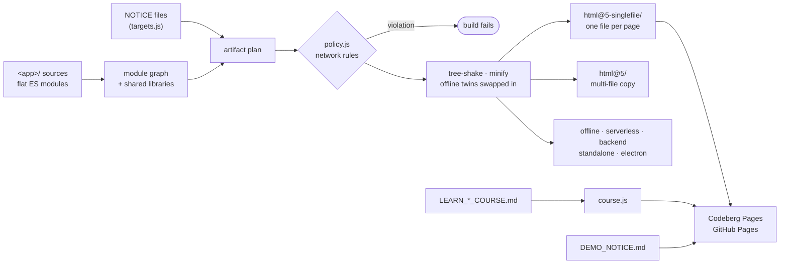

# in-html

Web applications that ship as **one self-contained HTML file** each: no dependencies, no CDN, no installation, no
account. 49 applications on about 90 shared libraries; sources are plain ES modules. By default the build
(`singlefile.js`) produces two artifacts per application:

- `<app>/html@5-singlefile/<page>.html` — every page as one self-contained, tree-shaken, minified file, ready to open
  from disk, e-mail, a USB stick or any static host;
- `<app>/html@5/` — a multi-file deployment copy: the pages, the application modules and only the library modules
  they use (as subfolders), every module tree-shaken and minified on its own — for static hosting with cacheable files.

The single-file pages are also published to Codeberg Pages and GitHub Pages under short names (`LANDING.html`,
`RESUME.html`, `DOCS.html`, `CRYPTO.hashing.html`, …), every application as an offline demo (`demo/<slug>.html`), and
the CSS courses as pages with live examples (`course/in-html/`).

An application can instead name its artifacts with **NOTICE files** — the file's presence is the request
(`targets.js`):

| NOTICE file in `<app>/` | artifact |
| --- | --- |
| `OFFLINE_NOTICE.md` | `html@5_offline/` — multi-file copy, no network code at all |
| `SINGLEFILE_OFFLINE_NOTICE.md` (or `OFFLINE_SINGLEFILE_…`) | `html@5_offline_singlefile/<page>.html` — one file per page, no network code |
| `SERVERLESS_NOTICE.md` | `html@5_serverless/` — static site for any static host (`404.html` routes) |
| `SINGLEFILE_SERVERLESS_NOTICE.md` | `html@5_serverless_singlefile/<app>.mjs` — one script for Node ≥ 18 that serves the site like GitHub Pages |
| `BACKEND_NOTICE.md` | `html@5_backend/` — `server.mjs` + `backend.mjs` (the bundled `<app>/backend.js`) + `public/` |
| `SINGLEFILE_BACKEND_NOTICE.md` | `html@5_backend_singlefile/<app>.mjs` — server, backend and pages in one script for Node ≥ 18 |
| `STANDALONE_NOTICE.md` | `html@5_standalone/<page>.html` — one file that opens from file:// and talks to servers over HTTPS + CORS (no server preset) |
| `ELECTRON_NOTICE.md` | `html@5_electron/` — a desktop application for Electron ≥ 29: `package.json` (`npm start` = `electron .`), `main.mjs` (the pages from a private `in-html://<app>/` scheme, the bundled `<app>/backend.js` in-process), `preload.cjs` (a small `window.inHtmlElectron` bridge), `public/` |
| `SINGLEFILE_ELECTRON_NOTICE.md` | `html@5_electron_singlefile/` — the same with the backend and the single-file pages inside `main.mjs` |

Every page learns its artifact from `globalThis.IN_HTML_ARTIFACT = { mode, singlefile, servers }`. Offline artifacts
replace modules that have an `x.offline.js` twin (for example `rooms/client.offline.js`), so they carry no network code;
generated servers are `hosting.js` (Node ≥ 18, no dependencies) plus the application's `backend.js`; Electron artifacts run
the same `hosting.js` and `backend.js` inside Electron's main process (`electron.js`), so a desktop build talks to the same
`/api` as the server build. The user installs Electron (`npx electron .` in the artifact folder); the repository has no
npm dependencies.

How the repository is organised (folders, libraries, engine, build, CI) is described in
[ARCHITECTURE.md](ARCHITECTURE.md).

> **Where it lives.** The origin is [codeberg.org/slnknrr/in-html](https://codeberg.org/slnknrr/in-html);
> [github.com/slnknrr-dev/in-html](https://github.com/slnknrr-dev/in-html) is a code-only mirror. The built pages are
> served from both Codeberg Pages and GitHub Pages.

## in-html and in-javascript

The two repositories are halves of one body of work:

| | [in-javascript](https://codeberg.org/slnknrr/in-javascript) | **in-html** (this repository) |
| --- | --- | --- |
| subject | the language: data structures, algorithms, ports, runtime behaviour | the web: applications, the browser, edge cases of web development |
| first priority | R&D — naive and canonical implementations, then other paradigms | frontend-first — a working, pleasant application |
| backend | foundations and components | servers that applications ship with (`hosting.js`, `backend.js`) |
| style of code | expressive JS: modules, metaprogramming, reuse | plain, programmatic, moderate JS that serves the page |
| build | `downgrade.js`: one snippet → artifacts for ES3 … ES2025, node 4 … 24 | `singlefile.js`: one application → single files, static sites, servers, desktop apps |

**Beautiful JavaScript lives in in-javascript; a beautiful, convenient frontend-first web lives here.** The code in
this repository is written for it on purpose: it does not import the snippets and does not follow their
metaprogramming style. It is straightforward code that a reader can follow from an event handler to the DOM. Ideas
travel between the repositories; the code is written anew for each side. Browser JavaScript and a web developer's
portfolio are to be judged here; the language itself, in in-javascript.

## From sources to artifacts



## Machine learning

Using this repository — code, documentation, artifacts, or derivatives of them — to train, fine-tune, evaluate or
otherwise develop machine-learning models is **not permitted without payment and the author's explicit written
consent**. A request must state the purpose and disclose the full chain: who will use the material, for what, and
every party it is passed or outsourced to. Write to slnknrr.dev@gmail.com.

## Application classes

| class | alternative | description |
| --- | --- | --- |
| frontend | client | Strictly backend-dependent: tied to a specific API; without it nothing is displayed or works. |
| spa | unhosted | Server-independent: runs in the browser. May need a local HTTP server to start (CORS / modules), but keeps the data with the user, not on a backend. |
| pwa | unhosted | Client with an SPA fallback: a full client, but when the network goes away a Service Worker switches the app into an autonomous SPA mode. |
| **isomorphic** | **unhostedable** | Client with a discovery fallback: an advanced hybrid. It looks for **a central API, and when there is none it starts self-discovery** of the local infrastructure. |
| standalone | – | Zero fetch / zero server: a fully autonomous application. Never calls servers with `fetch`. Works from `file://`. |

The suffix of an application folder declares its class, and the build enforces it ([policy.js](policy.js)):

| suffix | class | build rule |
| --- | --- | --- |
| `-offline`, `-effect` | standalone | the artifact must contain no network API and no remote resource, otherwise the build fails |
| `-serverless` | spa / unhosted | data stays with the user; requests the user configures are allowed and reported |
| `-pwa`, `-isomorphic` | pwa / isomorphic | reported |
| other | client | reported |

Application folders now go without a suffix and declare their artifacts with NOTICE files instead: an `OFFLINE`
NOTICE target (`html@5_offline/`, `html@5_offline_singlefile/`) is held to the same zero-network rule as a standalone
suffix, whatever the folder is called. The *class* column below names what the application is.

## Applications

| application | class | what it is | try it |
| --- | --- | --- | --- |
| [resume-app](resume-app/) | unhosted | Resume builder: a visual editor for multilingual, printable resume pages with attachments. | [open](https://slnknrr-dev.github.io/in-html/RESUME.html) · [demo](https://slnknrr-dev.github.io/in-html/demo/resume-builder.html) |
| [landing-studio](landing-studio/) | unhosted | Landing page builder: one-page sites with a shop cart, checkout, forms, chat, catalogues with search, a reader and an audio player, embedded files, portal blocks shared with the knowledge processor (legal acts with articles and cross-references, glossaries with term tooltips, directories, request boards matched with the directory, topic hubs, checklists, unified search), and ten designed templates (dance, winery, metallurgy, agro, legal, real estate, library, books, audio, legal portal). Requests can target browser-local `local:` endpoints, so a published page needs no server; it also exports static archives and *unhostedable* backend archives (a zero-dependency server with an admin console whose page still runs on static hosting). | [open](https://slnknrr-dev.github.io/in-html/LANDING.html) · [demo](https://slnknrr-dev.github.io/in-html/demo/landing-builder.html) |
| [site-studio](site-studio/) | client (offline single file / serverless / backend / electron) | Site Studio: one editor for landings, multi-page sites, portals, knowledge bases, shops and sites with accounts. Pages with a shared header and footer, menus and nested sections; every block of the landing builder and the portal; blocks on the repository's libraries (Mermaid-style diagrams and the site map, GitHub Markdown, TeX formulas, a booking price calendar, events with RSVP and .ics, offline maps with routes, real-estate units and floor chessboards, donations with a payment QR, CSV data tables, a unit converter, barcodes, contracts filled in by the visitor, sign-in and profile). Four packages: one offline file, a serverless site (prerendered pages + 404.html, or a single-page site of index.html + 404.html; browser-local endpoints, the owner's endpoints), a backend site with an admin console (accounts by password or e-mail link, roles and closed sections, content edited online) and a backend with the constructor itself at /_studio/. Sitemap, robots and llms.txt from seo/, a README for the site's repository, the site drawn as diagrams. 36 templates in three groups (knowledge base & wiki, landing & serverless, backend site) marked offline / serverless / backend with the modules they use; knowledge bases are sites of the same editor: every wiki block (infobox, references, navbox, annotated pictures, interlinear texts…), versions of a page, layers readers switch and password-encrypted 451 sections opened in the browser with Web Crypto. | [open](https://slnknrr-dev.github.io/in-html/SITE.html) · [demo](https://slnknrr-dev.github.io/in-html/demo/site-studio.html) |
| [bookmarks-editor](bookmarks-editor/) | client | Bookmarks: a bookmark manager (folders, tags, read later, favourites, archive, a search language, duplicates, imports from every browser and Pinboard / Pocket / Raindrop / Instapaper / linkding / Shaarli / CSV / Markdown, exports, context menus by right click and long press) that ships as one offline file, a self-hosted service for Node ≥ 18 (accounts with invitations, offline-first sync, public pages and Atom feeds, a bookmarklet, page metadata with SSRF protection) and a standalone file that syncs with that service. | [open](https://slnknrr-dev.github.io/in-html/BOOKMARKS.html) · [demo](https://slnknrr-dev.github.io/in-html/demo/bookmarks.html) |
| [book-processor](book-processor/) | standalone | Books: an FB2 / EPUB library and reader (paged or scrolling, five themes, contents, footnote pop-ups, search, bookmarks, highlights with notes, remembered positions, context menus on right click and long press) and a writer (chapter tree, WYSIWYG chapters with poems, epigraphs, footnotes, images and tables, styles, details, generated covers, a check that validates the files) exporting EPUB 3 / EPUB 2 / FB2 / Markdown / HTML / text — all on one format-neutral book model; drafts and books stay in the browser. | [open](https://slnknrr-dev.github.io/in-html/BOOK.html) · [demo](https://slnknrr-dev.github.io/in-html/demo/books.html) |
| [docs-app](docs-app/) | standalone | Document editor: rich documents with code highlighting, contents, checklists; Markdown / ZIP import and export; exports single-file pages. | [open](https://slnknrr-dev.github.io/in-html/DOCS.html) · [demo](https://slnknrr-dev.github.io/in-html/demo/docs.html) |
| [sheets-processor](sheets-processor/) | standalone | Spreadsheets: CSV / TSV / XLSX / ODS / JSON in, XLSX / CSV / JSON / HTML / Markdown out, 190 formula functions, sort, filter, group, charts. | [open](https://slnknrr-dev.github.io/in-html/SHEETS.html) · [demo](https://slnknrr-dev.github.io/in-html/demo/sheets-processor.html) |
| [image-processor](image-processor/) | standalone | Batch image processing (PNG / JPEG decode and encode, operations pipeline, metadata) and a Photoshop-like editor (layers, masks, blend modes, selections, brushes, adjustment layers, filters) — the pipeline and every layered document shown as one ImageMagick command for bash or cmd.exe, with the PNG files it reads. | [open](https://slnknrr-dev.github.io/in-html/IMAGE.html) · [demo](https://slnknrr-dev.github.io/in-html/demo/image-processor.html) |
| [video-processor](video-processor/) | standalone | Video editor like TikTok / Instagram: timeline of clips and pictures with transitions, filters, text, stickers, drawings and music, slideshows from a song and photos, export to WebM / MP4 — and every edit shown as an ffmpeg command for bash or cmd.exe. | [open](https://slnknrr-dev.github.io/in-html/VIDEO.html) · [demo](https://slnknrr-dev.github.io/in-html/demo/video-processor.html) |
| [crypto-tool](crypto-tool/) | standalone | Hashing, checksums, encryption, 37 binary-to-text encodings, a password generator from alphabets and a KeePassXC-style strength checker (zxcvbn). | [open](https://slnknrr-dev.github.io/in-html/CRYPTO.html) · [demo](https://slnknrr-dev.github.io/in-html/demo/crypto-tools.html) |
| [kdbx-app](kdbx-app/) | standalone | KeePass-compatible password manager (KDBX 3.1 / 4.x): groups and entries with the 69 standard and custom icons, an editable password generator with KeePassXC-style strength, TOTP, attachments, history, context menus with long press, multiple selection. | [open](https://slnknrr-dev.github.io/in-html/KDBX.html) · [demo](https://slnknrr-dev.github.io/in-html/demo/password-vault.html) |
| [qr-tool](qr-tool/) | standalone | QR code generator and camera / image scanner. | [open](https://slnknrr-dev.github.io/in-html/QR.html) · [demo](https://slnknrr-dev.github.io/in-html/demo/qr-studio.html) |
| [barcode-studio](barcode-studio/) | standalone (offline single file / offline builds) | Barcode Studio: EAN / UPC with add-ons, GS1-128, ITF-14, GS1 DataMatrix, Code 128 / 39 / 93, ITF, Codabar and Data Matrix at their true printed size — check digits completed and explained, a GS1 element builder that reads pasted scans and Digital Links, in-store weight / price codes, GS1 prefixes and ISBN / ISSN forms, a read-back check of every drawing; SVG in mm, PNG at a DPI, batches from lists or sequences as ZIP files and A4 label sheets; a scanner for images, the camera and USB keyboard-wedge scanners. | [open](https://slnknrr-dev.github.io/in-html/BARCODE.html) · [demo](https://slnknrr-dev.github.io/in-html/demo/barcode-studio.html) |
| [stock-analyzer](stock-analyzer/) | standalone (offline single file / offline builds) | Stock Analyzer: sales CSV / XLSX with auto-mapped columns (or a seeded grocery demo) → ABC / XYZ with a Pareto chart, the 3 × 3 matrix and advice, sortable tables with sparklines; a reorder planner (safety stock, lead and cover days, MOQ and multiples, supplier order days and holidays, orders by supplier); FEFO batches with markdowns and write-offs; CSV / XLSX exports. | [open](https://slnknrr-dev.github.io/in-html/STOCK.html) · [demo](https://slnknrr-dev.github.io/in-html/demo/stock-analyzer.html) |
| [receipt-studio](receipt-studio/) | standalone (offline single file / offline builds) | Receipt Studio: a cashier simulator — catalogue with EAN-13 items and scale codes, keyboard-wedge scanning, discounts and promotions, loyalty points, cash / card / mixed payments with change, receipts at 58 / 80 mm with a VAT table, Code 128 and QR; partial returns with refund splits; shift cash, X and Z reports, journal export. | [open](https://slnknrr-dev.github.io/in-html/RECEIPT.html) · [demo](https://slnknrr-dev.github.io/in-html/demo/receipt-studio.html) |
| [price-tags](price-tags/) | standalone (offline single file / offline builds) | Price Tags: products from CSV / XLSX or a table, promotions and expiry markdowns with the best price and the struck old one, unit prices; five tag templates in any size with EAN-13, Code 128 or GS1 DataMatrix, multilingual names; A4 sheets at true size with cut marks, only changed prices, SVG / PNG of one tag. | [open](https://slnknrr-dev.github.io/in-html/PRICE.html) · [demo](https://slnknrr-dev.github.io/in-html/demo/price-tags.html) |
| [planogram-studio](planogram-studio/) | standalone (offline single file / offline builds) | Planogram Studio: gondolas, wall racks, fridges and pegboards with shelves; a product library from CSV / XLSX; facings placed by drag or keyboard with rotation and auto depth; live fit checks with overflow and squeeze zones; space versus sales, days of supply; versions with diffs; a store floor plan linked to the planograms; SVG / PNG, print at scale, CSV, JSON. | [open](https://slnknrr-dev.github.io/in-html/PLANOGRAM.html) · [demo](https://slnknrr-dev.github.io/in-html/demo/planogram-studio.html) |
| [floor-planner](floor-planner/) | standalone (offline single file / offline builds) | Floor Planner: flats, floors, halls and shops in metres — polygon rooms with typed wall lengths, snapping, stencils, handles, layers, locks, undo; area, seat and sleeping-place summaries with overlap and aisle warnings; templates (studio, Euro two-room, wedding hall, shop); guest seating with a printed chart; SVG in mm at 1:20–1:500, PNG, print, JSON. | [open](https://slnknrr-dev.github.io/in-html/FLOOR.html) · [demo](https://slnknrr-dev.github.io/in-html/demo/floor-planner.html) |
| [rental-studio](rental-studio/) | standalone (offline single file / offline builds) | Rental Studio: short-let flats — a month timeline of bookings with conflicts and free gaps, iCal per flat; nightly prices with weekdays, seasons, minimum stays, length discounts and fees, quotes that explain refusals; payouts through a calculation web (owner, agency, cleaner, tax) posted to a journal, owner statements, occupancy / ADR / RevPAR, expense splits; a lead funnel with viewing clashes. | [open](https://slnknrr-dev.github.io/in-html/RENTAL.html) · [demo](https://slnknrr-dev.github.io/in-html/demo/rental-studio.html) |
| [newbuild-board](newbuild-board/) | standalone (offline single file / offline builds) | New-build Board: the floor × unit chessboard of a residential complex coloured by status or price per m², filters, unit cards with history, bulk price and status changes with undo, sales statistics; unit tables imported from CSV / XLSX; annuity and differentiated mortgage schedules with affordability; complex info and printable price lists; USD with a GEL rate. | [open](https://slnknrr-dev.github.io/in-html/NEWBUILD.html) · [demo](https://slnknrr-dev.github.io/in-html/demo/newbuild-board.html) |
| [event-invite](event-invite/) | standalone (offline single file / offline builds) | Event Invite: invitations for weddings, birthdays, supras, parties and conferences in up to 7 languages — date in words, venue, programme, dress code, themes and an opening envelope; exported as one zero-network HTML file with RSVP by mail / SMS / QR and personal guest links, plus .ics and printed cards; a guest list with groups, plus-ones, replies, tables, CSV and name cards. | [open](https://slnknrr-dev.github.io/in-html/EVENT.html) · [demo](https://slnknrr-dev.github.io/in-html/demo/event-invite.html) |
| [seo-kit](seo-kit/) | standalone (offline single file / offline builds) | SEO Kit: the machine-readable files of a static site — sitemaps with hreflang, robots.txt with a rule tester, llms.txt, JSON Feed / RSS / Atom, JSON-LD from forms with required-property checks, Open Graph / Twitter tags with a lint, all as one ZIP; an OG card designer (SVG / PNG); a checker of pasted pages. | [open](https://slnknrr-dev.github.io/in-html/SEO.html) · [demo](https://slnknrr-dev.github.io/in-html/demo/seo-kit.html) |
| [mail-composer](mail-composer/) | standalone (offline single file / offline builds) | Mail Composer: .eml messages built offline — address checks, encoded subjects, Markdown or rich text with a plain alternative, inline images and attachments, custom headers, mail merge into a ZIP; an inspector of .eml files (headers, MIME tree, sandboxed HTML, attachments); tools for encoded words, base64 / quoted-printable, SMTP transcripts, header injection. | [open](https://slnknrr-dev.github.io/in-html/MAIL.html) · [demo](https://slnknrr-dev.github.io/in-html/demo/mail-composer.html) |
| [unit-converter](unit-converter/) | standalone (offline single file / offline builds) | Unit Converter: one smart input in English, Russian or Georgian ("42,5 м²", feet and inches, "1 ч 30 мин") converted to every unit with formulas, favourites and history; price per unit, flat area from rooms, distance and Euro-layout scales; printable conversion tables. | [open](https://slnknrr-dev.github.io/in-html/UNIT.html) · [demo](https://slnknrr-dev.github.io/in-html/demo/unit-converter.html) |
| [route-planner](route-planner/) | standalone (offline single file / offline builds) | Route Planner: stops from pasted coordinates, links or CSV; routes ordered with pickups before deliveries and 2-opt, ETAs with time windows, manual reordering; a schematic SVG map (OSM fixture near Batumi); a printable trip sheet; CSV, GPX and polyline exports. | [open](https://slnknrr-dev.github.io/in-html/ROUTE.html) · [demo](https://slnknrr-dev.github.io/in-html/demo/route-planner.html) |
| [batumi-map](batumi-map/) | standalone (offline single file / offline builds) | Batumi Map: an offline vector map of Batumi from OpenStreetMap data (ODbL) — pan and zoom, styled roads, sea, labels, scale bar; search for streets and addresses in Georgian, Latin or Russian with house-number lookup; a street list of 535 streets and ~11 000 addresses with CSV exports. | [open](https://slnknrr-dev.github.io/in-html/BATUMI.html) · [demo](https://slnknrr-dev.github.io/in-html/demo/batumi-map.html) |
| [catalog-rules](catalog-rules/) | standalone (offline single file / offline builds) | Catalog Rules: category trees whose fields inherit, override or hide, with the origin of every resolved field and a live validated form; listing title rules and tag templates in ka / ru / en tested on sample objects with a tracer; real-estate and grocery demos, JSON projects. | [open](https://slnknrr-dev.github.io/in-html/CATALOG.html) · [demo](https://slnknrr-dev.github.io/in-html/demo/catalog-rules.html) |
| [access-designer](access-designer/) | standalone (offline single file / offline builds) | Access Designer: roles with inheritance and a grant / revoke matrix that explains every cell, members with expiring grants and "view as"; data policies cascading org → role → member; a module catalogue with dependency cascades; session scopes and TTL; layered configuration with value sources; JSON, CSV and printed documentation. | [open](https://slnknrr-dev.github.io/in-html/ACCESS.html) · [demo](https://slnknrr-dev.github.io/in-html/demo/access-designer.html) |
| [pallete-app](pallete-app/) | standalone | Palette Studio: harmonies, scales, contrast (WCAG / APCA), colour-blindness simulation, image extraction, swatch exports. | [open](https://slnknrr-dev.github.io/in-html/PALLETE.html) · [demo](https://slnknrr-dev.github.io/in-html/demo/palette-studio.html) |
| [icon-creator](icon-creator/) | standalone | Icon Creator: Aseprite-like pixel editor for application icons; magic wand background removal, a 256 px master and up to five sizes (32–256) drawn automatically or by hand, square crop of large pictures, .ico / .png export, projects. | [open](https://slnknrr-dev.github.io/in-html/ICON.html) · [demo](https://slnknrr-dev.github.io/in-html/demo/icon-creator.html) |
| [language-studio](language-studio/) | backend, serverless, offline | Language Studio: Vedic Sanskrit, Georgian, Mingrelian, Japanese, Chinese, Korean, Russian and English — lessons, word splitters and constructors (Georgian verb slots, sandhi, compounds, meters, characters, Russian morphemes), a Georgian dictionary of ~1 600 headwords with every word form, typing Georgian in Latin or Russian transcription with corrections, a sentence designer that explains the cases, a morpheme parser before the dictionary (Georgian, Russian, English: probable rules, search by preverb / prefix / root / suffix, every word a root can make, labels of everyday use, correctness and literariness that filter the dictionary), Korean Hangul pronunciation and a word parser, Mingrelian cognates with Georgian, text analysis with entity, clause and topic graphs, dialogue speakers and the author's words, letter games, drawing letters by strokes with measured deviation, spaced repetition; C1 / C2 lessons (English, Russian, Georgian; Sanskrit C2; Japanese, Chinese, Korean C1) with quizzes and links into the tools; across languages: word families (cognates, loans, calques), one dictionary over all courses with back-lookup, Latin typing of every script, cards between any two languages, aligned parallel texts with entities matched, the sentence designer against Russian and English, the same sound in another script; accounts with server-side progress or IndexedDB; a rhyme and meter workshop for English, Russian and Georgian (stress, syllables, meters incl. Georgian shairi, rhyme distance and the catch of each line, suggested endings and word forms, analysed examples from Shakespeare, Rustaveli and public-domain translations of Dante); C1 / C2 lessons and cross-language tools (word families, one dictionary over all courses, any-pair flashcards, parallel texts). | [open](https://slnknrr-dev.github.io/in-html/LANGUAGE.html) · [demo](https://slnknrr-dev.github.io/in-html/demo/language-studio.html) |
| [img2ascii-app](img2ascii-app/) | standalone | Image and camera to ASCII / ANSI / braille art with PNG, SVG, HTML and text export. | [open](https://slnknrr-dev.github.io/in-html/IMG2ASCII.html) · [demo](https://slnknrr-dev.github.io/in-html/demo/image-to-ascii.html) |
| [digitalrain-effect](digitalrain-effect/) | standalone | Digital rain effect designer with standalone HTML, embed snippet, video and wallpaper export. | [open](https://slnknrr-dev.github.io/in-html/DIGITALRAIN.html) · [demo](https://slnknrr-dev.github.io/in-html/demo/digital-rain-creator.html) |
| [durak-game](durak-game/) | standalone / client | Durak, the card game: podkidnoy, perevodnoy, jokers, double decks, teams and five exclusive variants on a data-driven rules engine; strategist bots with different principles and four levels (ratings and "who disrupts whom" from simulations); replays with a game notation (DGN) and the entropy of the public course; style profile and achievements; online rooms with passwords, invite links and synced looks; a constructor for decks of any size, custom cards with their own rules, looks and bots, with export of rulesets and of a standalone page with servers. | [open](https://slnknrr-dev.github.io/in-html/DURAK.html) · [demo](https://slnknrr-dev.github.io/in-html/demo/durak.html) |
| [battleship-game](battleship-game/) | client (offline / serverless / backend builds) | Sea Battle (Battleship): the school game, the board-game rules, Salvo, volleys, fog of war, islands, polyomino fleets, free-for-all and teams, radar / air strike / cluster bomb / mines on a data-driven rules engine; bots with eight personalities and four levels (Monte-Carlo fleets, exact endgames; ratings and who beats whom from simulations); placement by drag, turn and random strategies; replays with the information of every shot in bits, luck and skill; style profile and achievements; online rooms with passwords, invite links, chat and synced looks; a constructor for seas, islands, ship shapes, fleets, rules and bots. | [open](https://slnknrr-dev.github.io/in-html/BATTLESHIP.html) · [demo](https://slnknrr-dev.github.io/in-html/demo/sea-battle.html) |
| [embroidery-studio](embroidery-studio/) | client (offline / serverless / backend builds) | Cross-stitch scheme site, viewer and editor: a catalogue of original schemes with search and filters; scheme pages with the key sorted by count, skeins, the shopping list, fabric size, equivalents in five thread brands (DMC, Anchor, Madeira, Gamma, PNK Kirova); a viewer that marks stitched cells (taps, drags, colour regions, parking) and keeps the progress; an editor with full / half / quarter / three-quarter / petite stitches, backstitch, French knots, beads, blends, layers, selections and text; a picture-to-chart converter; PDF with vector symbols and page splitting, OXS, JSON, PNG, SVG, printing; uploads with moderation and progress sync on the backend. | [open](https://slnknrr-dev.github.io/in-html/EMBROIDERY.html) · [demo](https://slnknrr-dev.github.io/in-html/demo/embroidery-studio.html) |
| [carpet-generator](carpet-generator/) | client (offline / serverless builds) | Rug designs on a knot grid: Persian, Anatolian, Caucasian, Turkmen, Nordic rya, modern, Indian, Arab and Moroccan, Ottoman Turkish, Armenian and Georgian traditions and a mash-up tradition; composition layers of 37 ornaments, fractals (Mandelbrot, Julia, Newton, Sierpinski, Hilbert, dragon curves, Koch, L-systems…) and abstractions with masks, outlines, kaleidoscopes and polar / wallpaper warps; a gallery of 30 exclusive designs; a knot editor with symmetric brushes, fills and motif stamps; field symmetries and the 12 wallpaper groups; borders with guards and corner resolution; natural dye palettes; seeds and share codes; pile, flat, knotting-chart and room views with an antique wash; yarn and time estimates; a motif editor; PNG, SVG, knotting PDF and cross-stitch PDF / OXS / JSON for Embroidery Studio. | [open](https://slnknrr-dev.github.io/in-html/CARPET.html) · [demo](https://slnknrr-dev.github.io/in-html/demo/carpet-generator.html) |
| [agreement-constructor](agreement-constructor/) | client (offline single file / serverless builds) | Agreement Constructor: contract templates and documents — modifier buttons (power of attorney, additional services, special terms), strictness levels, a library in IndexedDB with template versions, the live A4 contract editable in place, fields extracted from the text, a sandboxed JS validator, languages with a main one, payment schedules from the 23rd to the 22nd, amounts and dates in words, printing, and templates compiled into one offline HTML fill-in page. | [open](https://slnknrr-dev.github.io/in-html/AGREEMENT.html) · [demo](https://slnknrr-dev.github.io/in-html/demo/agreement-constructor.html) |
| [readme-editor](readme-editor/) | standalone (offline single file / serverless builds) | README Editor: the Markdown source and the README as GitHub or Codeberg render it, edited in place — text, tables, images, shields.io badges with local previews, formulas (TeX → MathML), Mermaid-style diagrams (12 kinds), alerts, footnotes, a table of contents; a project folder with relative images, outline and hints; remote images only on request. | [open](https://slnknrr-dev.github.io/in-html/README.html) · [demo](https://slnknrr-dev.github.io/in-html/demo/readme-editor.html) |
| [miner-game](miner-game/) | standalone | Sapper: Minesweeper for desktop and phones — any size up to 500 × 500, hexagons, torus and knight-move variants, boards without guessing, alphabets instead of numbers, six themes, seeded (PRNG) or secure (CSPRNG) boards with share links, replays, statistics. | [open](https://slnknrr-dev.github.io/in-html/MINER.html) · [demo](https://slnknrr-dev.github.io/in-html/demo/sapper.html) |
| [sudoku-game](sudoku-game/) | client (offline / serverless / backend / standalone builds) | Sudoku Variants: 40 variants (killer, jigsaw, samurai, thermo, arrow, kropki, sandwich, whispers and many rare ones), 4 × 4 to 25 × 25 in the list and any typed size up to 64 × 64, hints that explain the logic, custom symbols, seeded (PRNG) or secure (CSPRNG) puzzles with share links, a daily puzzle, six looks, games against bots and online rooms (shared grid or race) with invite links. | [open](https://slnknrr-dev.github.io/in-html/SUDOKU.html) · [demo](https://slnknrr-dev.github.io/in-html/demo/sudoku-variants.html) |
| [regexp-app](regexp-app/) | standalone | Regex Studio: live matching, explanation, railroad diagrams, lint warnings, code snippets, 62 strict RFC validators and number / word-list generators. | [open](https://slnknrr-dev.github.io/in-html/REGEXP.html) · [demo](https://slnknrr-dev.github.io/in-html/demo/regex-studio.html) |
| [knowledge-processor](knowledge-processor/) | client | Knowledge bases and wikis: Wikipedia-like blocks (infobox, references, navbox, timeline), annotated pictures with clickable regions and leader lines, hover previews, versions of a page, toggle layers for translations and transcription, password-encrypted "451" pages; portal blocks shared with the landing builder (legal acts, glossaries linked across the base, directories, request boards, topic hubs, checklists, search with type tabs); nine templates (encyclopedia, fandom, news, song analysis, Gaudiya Vaishnava, Japanese, Georgian, legal knowledge base, blank). Publishes one HTML file, a static site with 404.html routing or a Node server; artifacts: offline single file, serverless, backend. | [open](https://slnknrr-dev.github.io/in-html/KNOWLEDGE.html) · [demo](https://slnknrr-dev.github.io/in-html/demo/knowledge-processor.html) |
| [media-player](media-player/) | client (electron / serverless / backend / offline single file builds) | Media player in the general sense: music, audiobooks, series, anime, movies, music videos and podcasts; real files, links that yt-dlp streams or downloads, and cards known only by their description; virtual tags, smart and mood playlists, workspaces, tracking like MyAnimeList / Shikimori with statistics, index rules for folders and links, a converter with yt-dlp / ffmpeg / ImageMagick (every command shown for bash and cmd.exe), your own skins, player layouts and covers, mobile, desktop and home-theatre modes. Artifacts: Electron app, home media server, static site. | [open](https://slnknrr-dev.github.io/in-html/MEDIA.html) · [demo](https://slnknrr-dev.github.io/in-html/demo/media-player.html) |
| [funding-studio](funding-studio/) | client (serverless / backend builds) | Donation pages: multilingual campaigns with a live goal, amount picker (presets, custom, one-time / monthly, currencies), rewards, impact lines, a moderated donor wall and leaderboard, updates, FAQ, matching, countdown, transparency, sharing and thank-you pages; Stripe, PayPal, TBC Bank, bank transfer with EPC QR, Bitcoin (BIP-21) and Ethereum (EIP-681, browser wallets); five fictional templates. Exports one HTML file or a static site that work without a server, or pages served by its own backend for Node ≥ 18 (provider keys on the server only, checkouts and verified webhooks, ledger, recurring donors, receipts, CSV / JSON export, crypto detection, admin console). | [demo](https://slnknrr-dev.github.io/in-html/demo/funding-studio.html) |
| [bitcoin-wallet](bitcoin-wallet/) | client (offline / serverless / backend builds) | Bitcoin wallet, explorer and dashboard: HD wallets (BIP-39, BIP-44 / 49 / 84 / 86) with a backup check, watch-only xpubs / descriptors / addresses, coin control, RBF and CPFP, PSBTs by file and QR for air-gapped signing, BIP-137 / BIP-322 messages, BIP-329 labels, an address book; blocks, transactions with verified scripts, addresses, mempool; portfolio, balance history, coins, fee market. Keys stay in an encrypted vault in the browser; builds: a zero-network cold wallet in one file, a static site for the Esplora servers you choose, a server for your Bitcoin Core / Electrum node. | [open](https://slnknrr-dev.github.io/in-html/BITCOIN.html) · [demo](https://slnknrr-dev.github.io/in-html/demo/bitcoin-wallet.html) |
| [ethereum-wallet](ethereum-wallet/) | client (offline / serverless / backend builds) | Ethereum wallet, explorer and dashboard for Ethereum and EVM chains: HD wallets, imported keys and keystores, watch-only addresses and ENS names, ETH and ERC-20 sends with EIP-1559 fees, nonces, speed-up and cancel, offline signing with QR export, personal_sign and EIP-712; blocks, transactions with decoded calldata and logs, addresses, contract reads with a pasted ABI; portfolio, balance snapshots, gas tracker. Keys stay in an encrypted vault in the browser; builds: a zero-network cold wallet in one file, a static site for the JSON-RPC URLs you choose, a server for your own node. | [open](https://slnknrr-dev.github.io/in-html/ETHEREUM.html) · [demo](https://slnknrr-dev.github.io/in-html/demo/ethereum-wallet.html) |
| [textile-studio](textile-studio/) | client (offline single file / serverless builds) | Textile Studio: a parametric body (sex, height, weight, age, pose, twelve features, editable ISO-style measurements, nearest sizes) → garment patterns drafted from it (13 templates and whole outfits such as the tuxedo) → details layered from the inside out (linings, canvas, interfacings, facings, lapels, collars, pockets, satin trims); a fabric editor (24 presets, weaves with weaving drafts and your own drawdowns, knits, jacquards, colour orders and tartan setts, physical properties) and a print editor (repeats, colourways, separations, placement prints with your artwork) at every step; the 2D pattern, flats, cutting layout and grading beside a 3D cloth simulation of the outfit on the body; a merch Mockup mode; exports of tiled print-at-home PDF, SVG, DXF (AAMA), graded nests, layouts, flats, screenshots and mockup images. National costumes (Georgian chokha and kartuli, Slavic kosovorotka, kaftan, sarafan), jackets, women's and children's bodies, ready outfits, layers worn over layers, 2D pattern editing with layers, materials and dyes, material usage, DXF import. | [open](https://slnknrr-dev.github.io/in-html/TEXTILE.html) · [demo](https://slnknrr-dev.github.io/in-html/demo/textile-studio.html) |
| [archive-processor](archive-processor/) | standalone | Archive processor: list, preview, test and extract ZIP, 7z, RAR (extraction only), tar, tar.gz / bz2 / xz / zst, gz, bz2, xz, zst, ISO / UDF and ARC; encrypted and multi-volume archives; output as files, one ZIP or into a folder. A two-panel commander with the keys of Far Manager creates ZIP, 7z, tar, tar.gz / bz2 / xz / zst, gz, bz2, xz, zst and lzma, opens archives as folders and copies into, out of and between them, with a hex / text viewer (format structures, search, encodings), MIME types by signature, checksums, integrity tests and file comparison. | [open](https://slnknrr-dev.github.io/in-html/ARCHIVE.html) · [demo](https://slnknrr-dev.github.io/in-html/demo/archive-processor.html) |

Each application folder has its own README; its built artifacts are in its `html@5*/` folders — the defaults
`html@5-singlefile/` and `html@5/`, or the ones its NOTICE files name.

## Libraries

Folders without `-` are libraries shared by the applications (flat ES modules with a README where the API is
non-trivial): document engine `doc/`, paper documents `paper/`, editor `studio/`, rich text `richtext/`, UI kit
`ui/`, `html/`, `i18n/`, `util/`, `minify/`, `codec/` (deflate, CRC, Base16…Base100, Bech32, UU / yEnc, quoted-printable, percent, Punycode), `zip/`, `xml/`, `markdown/`,
`highlight/`, `portal/` (legal acts, glossaries, directories, request boards, topic hubs, checklists, unified search: models, logic, markup, CSS, runtime shared by landing and knowledge), `spa/` (routes, hash / path routers, base detection, prerendering, 404.html bootstrap), `color/`, `qr/`, `crypto/`, `kdbx/`, `png/`, `jpg/`, `raster/`, `webm/`, `weba/`, `mp4/`, `mp3/`, `ogg/`, `wav/`, `csv/`,
`xlsx/`, `formula/`, `ascii/`, `rain/`, `regexp/`, `photo/` (photo editor core and its documents as ImageMagick commands), `cmdline/` (bash / cmd.exe quoting), `book/` (book model with FB2 / EPUB / Markdown / HTML / text converters and validators), `bookmarks/` (bookmark library with replicated records and sync, imports / exports, search language), `timeline/` (video projects), `ffcmd/` (ffmpeg command text), `archive/` (archive formats, read only), `pack/` (archive writers: tar, gzip, bzip2, xz / LZMA2, Zstandard, 7z), `magic/` (file types by signature, binary structures), `prng/` (seeded and crypto random), `mines/` (Minesweeper engine), `durak/` (Durak rules engine, bots, notation), `battleship/` (Sea Battle rules engine, solver, bots, notation), `sudoku/` (Sudoku engine: variants, solvers, generator), `rooms/` (multiplayer rooms), `fileapi/` (file API server and client), `catalog/` (media catalogue), `player/` (playback logic, skins, layouts), `mediatags/` (media tags and sidecars), `mediajobs/` (yt-dlp / ffmpeg / ImageMagick jobs), `payments/` (money amounts, IBAN / EPC QR, Stripe, PayPal and TBC Bank clients with mock providers), `stitch/` (cross-stitch charts, thread catalogues, OXS / PDF), `carpet/` (rug designs on a knot grid, composition layers, fractals, hand edits), `contract/` (contract templates, billing periods, amounts in words, compiled fill-in pages), `diagram/` (Mermaid-style diagrams: graph layout and SVG), `math/` (TeX to MathML), `badge/` (shields.io badges drawn locally), `hdkey/` (BIP-39 mnemonics, BIP-32 / SLIP-132 keys), `bitcoin/` (scripts and interpreter, addresses, transactions, PSBT, descriptors, accounts, coin selection, BIP-322, clients), `ethereum/` (transactions, ABI, EIP-712, keystores, ENS, JSON-RPC), `walletui/` (vault, recovery phrases, QR, address book, charts of the wallets), `body/` (parametric bodies, measurements, sizes), `garment/` (pattern drafting, layered details, seams, grading, nesting, PDF / SVG / DXF), `fabric/` (weaves, knits, fabric presets, textures), `motif/` (print design), `cloth/` (cloth simulation), `view3d/` (WebGL and software renderers), `mockup/` (garment previews from a serialisable spec, embeddable viewer), `sample/`.

## Build and check

Node ≥ 22.12 (or Bun); nothing to install — the parser, bundler, minifiers and builder are in the repository root.

```bash
node singlefile.js
```

```bash
node check.js
```

The first builds every application into the artifacts its NOTICE files name; the second runs the checks that need no
browser (module links, library unit tests, the network audit of the artifacts, Electron artifacts). `node server.js`
serves the sources for development; `node check.js page | e2e | golden` drive a headless Chrome / Edge.

CI runs the same on both sides: Forgejo Actions on Codeberg build, prove the output reproducible, check, commit
the artifacts and publish pages, demos and courses to Codeberg Pages; GitHub Actions on the mirror do the same checks
and deploy the same tree to GitHub Pages, without committing.

Every command, flag, artifact, NOTICE file, the pipeline and both CI setups:
[README_FOR_DEVOPS.md](README_FOR_DEVOPS.md).
