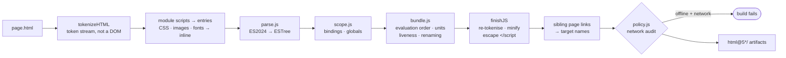
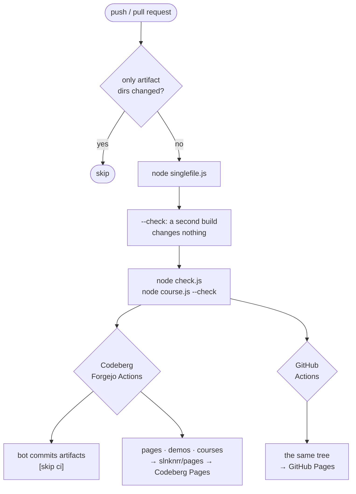

# README for devops

How the repository builds its artifacts, how to run and check it, and how CI publishes it.

The tooling is a self-written, zero-dependency toolchain in the repository root: an ECMAScript 2024 parser, scope
analysis, a tree-shaking bundler, minifiers for HTML, CSS and JS, and a builder that turns every application into the
artifacts its NOTICE files ask for. It is plain Node.js ≥ 22.12 or Bun (CI uses Node 24). There is nothing to install:
no `package.json` and no `node_modules`.

> The sister repository [in-javascript](https://codeberg.org/slnknrr/in-javascript) has its own toolchain,
> `downgrade.js`, which lowers snippets to ES3 … ES2025. Here the job is different: the target is the browser, and the
> unit is the application.

---

## Quick start

```bash
node singlefile.js
```

```bash
node check.js
```

The first command builds every application. The second runs every browser-less check. Run both before a commit.

| command | what it does |
| --- | --- |
| `node singlefile.js [app …]` | build the artifacts of every application, or only the named ones |
| `node singlefile.js --check` | build in memory and exit 1 when an artifact is missing or stale; writes nothing |
| `node singlefile.js --publish <dir>` | also write the single-file pages under their publishing names (`LANDING.html`, …) |
| `node singlefile.js --target demo --demo <dir>` | build the offline single-file demos (`DEMO_NOTICE.md`) into `<dir>` |
| `node server.js [port] [--api]` | development server for the sources, optionally with an in-memory mock JSON API |
| `node check.js` | module links + library unit tests + network audit + Electron checks |
| `node check.js page <url\|file>` | open a page in headless Chrome: console errors, `--eval`, `--shot` |
| `node check.js e2e <url\|file> <scenario.js>` | run an in-page end-to-end scenario |
| `node check.js golden <app> <outDir>` | deterministic exports of every template, to prove a refactoring changed nothing |
| `node course.js --fix` · `--check` · `--out <dir>` | maintain and build the learning courses |

Flags of `singlefile.js`: `--target singlefile | files | demo`, `--no-minify`, `--check`, `--quiet`,
`--publish <dir>`, `--demo <dir>`. Every script prints its usage from its header comment.

## What is an application

A **top-level directory whose name contains `-`** is an application (`resume-app/`, `kdbx-app/`, `site-studio/`).
A directory without `-` is a shared library (`ui/`, `doc/`, `png/`, `zip/`, …). Dot-directories (`.t9n/`, `.@foofe/`)
and **artifact directories** (depth 2, name contains `@`) are never read as sources. Applications import libraries by
`../` paths, so the sources run unbundled from the repository root. The build is what removes the `../`.

## Artifacts and NOTICE files

Without NOTICE files an application gets two default artifacts:

| artifact | contents |
| --- | --- |
| `<app>/html@5-singlefile/<page>.html` | one self-contained, tree-shaken, minified file per page; opens from `file://` |
| `<app>/html@5/` | multi-file copy: pages, app modules and the library modules they use as subfolders, each shaken on its own |

When an application holds NOTICE files, it gets **exactly** the artifacts they name. The presence of the file is the
request, and the notice doubles as the documentation of what the artifact promises (`targets.js`):

| NOTICE file | artifact |
| --- | --- |
| `OFFLINE_NOTICE.md` | `html@5_offline/`: multi-file, zero network |
| `SINGLEFILE_OFFLINE_NOTICE.md` | `html@5_offline_singlefile/<page>.html`: one file per page, zero network |
| `SERVERLESS_NOTICE.md` | `html@5_serverless/`: static site for any static host, with `404.html` routing |
| `SINGLEFILE_SERVERLESS_NOTICE.md` | `html@5_serverless_singlefile/<app>.mjs`: one script that serves the site like GitHub Pages |
| `BACKEND_NOTICE.md` | `html@5_backend/`: `server.mjs` + `backend.mjs` + `public/` |
| `SINGLEFILE_BACKEND_NOTICE.md` | `html@5_backend_singlefile/<app>.mjs`: server, backend and pages in one script |
| `STANDALONE_NOTICE.md` | `html@5_standalone/<page>.html`: opens from `file://`, talks to servers over HTTPS + CORS |
| `ELECTRON_NOTICE.md` | `html@5_electron/`: a desktop application for Electron ≥ 29 |
| `SINGLEFILE_ELECTRON_NOTICE.md` | `html@5_electron_singlefile/`: the same with backend and pages inside `main.mjs` |
| `DEMO_NOTICE.md` | not committed; built by CI into `demo/<slug>.html` on Pages (`# RESUME BUILDER` → `resume-builder.html`) |

`SINGLEFILE` may stand on either side of the name. Having it on both sides is an error. Unknown names are ignored, and
`check.js` reports the missing artifact. Artifact folders that no notice asks for any more are removed.

Every page learns its artifact from `globalThis.IN_HTML_ARTIFACT = { mode, singlefile, servers }`. In offline
artifacts an import of `./x.js` resolves to `./x.offline.js` when that twin exists, so they carry no network code at all.

## The pipeline



| file | role |
| --- | --- |
| `singlefile.js` | the build: pages → artifacts, `--check`, `--publish`, demos |
| `targets.js` | NOTICE files → artifact plan; writes servers and Electron folders |
| `multifile.js` | the multi-file copy: bundler split mode, one tree-shaken module per source |
| `bundle.js` | ES module bundler: scope hoisting and side-effect-aware tree shaking; offline variants; `?bundle` assets |
| `parse.js` | ECMAScript 2024 parser, ESTree as acorn emits it, with a token stream |
| `scope.js` | scope analysis for the bundler's liveness and collision-free renaming |
| `minify/` | HTML, CSS and JS minifiers working on token streams |
| `policy.js` | application classes and the textual network audit of the **final** artifact |
| `hosting.js` | the server inside generated artifacts (Node ≥ 18, `node:` modules only, copied verbatim) |
| `electron.js` · `electron-preload.cjs` | main process and preload of Electron artifacts |
| `server.js` | development server for the sources (+ mock `/api`) |
| `mime.js` | one media-type table for the dev server and the builder |
| `check.js` · `check-electron.js` · `check-editor.js` | checks: modules, tests, audit, Electron, headless browser, e2e |
| `course.js` | `LEARN_*_COURSE.md` → course pages with live examples |

Key decisions, in short:

- **Markup is re-serialised from tokens, not from a DOM.** The author's optional tags, attribute order and `<pre>`
  whitespace survive the build.
- **The emitted output is spliced from the original source text,** not printed from an AST, so every literal stays
  exactly as written.
- **The network audit reads the built bytes,** not the sources. Sources lie by omission, because a bundled helper can
  bring network code nobody wrote in the app. A false positive is loud and cheap to fix, while a false negative would
  silently break the "works offline" promise.
- **Generated servers have zero dependencies** and bind to `127.0.0.1` by default, so the artifact still runs with a
  bare `node` years later.

## Generated servers and desktop builds

A BACKEND target needs `<app>/backend.js` whose default export is `(ctx) => ({ handle(req, res, url) })`. The backend
reaches Node through `ctx.node` (http, fs, crypto, child_process, …) and never through imports, because the bundler
resolves only relative files. Its storage is `ctx.storage`, and `ctx.mode` tells whether it runs as `backend`,
`electron` or `dev`.

```bash
node html@5_backend_singlefile/<app>.mjs 8080 --host 0.0.0.0 --data ./data
```

The default port is 8080 (the next free one when it is taken), the host is `127.0.0.1` and the data folder is `./data`.
The same settings can come from `PORT`, `HOST` and `DATA_DIR`.

Electron artifacts serve the pages from a privileged `in-html://<app>/` scheme without opening a TCP port. Windows run
with context isolation and the sandbox on, without Node integration. A CSP lists the SHA-256 hashes of the inline
scripts. `<app>/electron.json` configures the window, a mini player, the external-link allowlist and the CSP. Users
start the app with `npx electron .` in the artifact folder. `node check.js electron` checks the artifacts under a stub
of the `electron` module, so CI needs neither the binary nor a display.

## Checks

`node check.js` runs without a browser and exits 0 or 1:

- **modules**: imports every library and application module in Node, so link errors (missing exports, syntax)
  surface. Browser-only failures are skipped.
- **tests**: `<lib>/test.js` exports `run()` and returns its failures.
- **audit**: the network policy of every built artifact.
- **electron**: scheme, window security, CSP, IPC and preload of the Electron artifacts.

The browser commands (`page`, `e2e`, `golden`) drive a local Chrome, Chromium or Edge through the DevTools protocol over
Node's built-in WebSocket, with no Puppeteer and no download. `CHROME=<path>` overrides the lookup.

## Courses

`LEARN_*_COURSE.md` at the top level and in `.t9n/<lang>/` are plain GFM that reads well on Codeberg. `course.js`
publishes each one as `course/in-html/<slug>.html` (or `<lang>/course/in-html/…`). Every example inside a `<details>`
block with an ```` ```html ```` fence becomes its own document, `<slug>/example-<n>.html`, shown live through
`<object>`. Example numbering is positional, so run `node course.js --fix` after adding or reordering examples. CI runs
`--check`.

## CI

Two workflows run one pipeline, one on the origin and one on the mirror:



| | [.forgejo/workflows/html5.yml](.forgejo/workflows/html5.yml) | [.github/workflows/html5.yml](.github/workflows/html5.yml) |
| --- | --- | --- |
| runs on | Codeberg, `codeberg-tiny`, `node:24-bookworm` | GitHub, `ubuntu-latest`, `node:24-bookworm` |
| build, reproducibility, checks, courses | yes | yes |
| commits artifacts back | yes, as `html@5 bot`, `[skip ci]` | no: the mirror never writes, so it cannot diverge from the origin |
| publishes | to the Pages repository `slnknrr/pages` → Codeberg Pages | as a Pages artifact → GitHub Pages |
| loop protection | `paths-ignore` + a guard over `git diff` | `paths-ignore` |

The pull-request behaviour is the same on both sides. Stale artifacts are only reported, and they are rebuilt after
the merge.

**Codeberg setup.** Enable Actions in the repository settings. Pushing back uses the automatic token; set the secret
`CI_TOKEN` if the repository restricts that token. Publishing needs the secret `PAGES_TOKEN`, a token with write
access to the Pages repository. The variables `PAGES_REPO` (default `slnknrr/pages`) and `PAGES_BRANCH` (default
`main`) choose the target. Without `PAGES_TOKEN` the publish job only builds and lists the pages.

**GitHub setup.** Settings → Pages → Source: GitHub Actions. No secrets are needed.

The course pages link their previews to `https://slnknrr.codeberg.page/` (`PAGES` in `course.js`), so the copy on
GitHub Pages links back to Codeberg Pages for the live examples.
