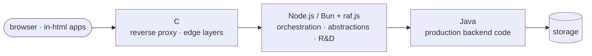

# Web Development CV

[← in-html](https://codeberg.org/slnknrr/in-html/src/branch/all-in-one/)
· [slnknrr →](https://codeberg.org/slnknrr/.profile/src/branch/about/)

## Profile

Web developer focused on JavaScript, backend development, and the engineering of maintainable software systems. Work includes building reusable libraries, developing server-side functionality, structuring codebases, automating development workflows, and documenting technical decisions.

Interested in practical web applications, backend architecture, performance, and low-dependency solutions. Prefer explicit data flow, small reusable components, and maintainable implementations over unnecessary abstraction.

## Direction

The stack my research is converging on, with each language in the layer it is best at:

- **Java**: the production backend, where it matters that code is typed, long-lived and maintained by a team.
- **Node.js / Bun with raf.js** (my own library): the orchestrator and the place for abstractions and R&D, where ideas
  are proven before they are hardened.
- **C**: the reverse proxy and similar thin layers close to the network, where every allocation and syscall counts.

This is the natural continuation of my current work, not a change of direction. in-javascript already explores what
the runtime costs, and in-html already ships its own servers.

## Technical Skills

- **Languages:** JavaScript, HTML, CSS; working knowledge of C and Java.
- **Runtime & Backend:** Node.js, Bun; server-side development, request handling, networking, and backend architecture.
- **Web Development:** Modular application design, reusable components, client-server interaction, application structure, and web deployment.
- **Data & Storage:** SQLite, binary data handling, data structures, and serialization.
- **Libraries & Packages:** Designing reusable JavaScript libraries, npm packages, public APIs, and dependency-light implementations.
- **Browser Platform:** Web Crypto, IndexedDB, Service Workers, WebGL, Canvas, media and camera APIs, File API, printing at true size.
- **Development Workflow:** Git, Forgejo Actions and GitHub Actions, reproducible builds, Codeberg Pages and GitHub Pages, headless-browser tests, cross-version compatibility.
- **Documentation:** Technical specifications, README files, API documentation, development conventions, and architectural notes.
- **Performance & Security:** Allocation-conscious programming, runtime behavior, protocol fundamentals, and security-oriented engineering.

## Selected Projects

### batume.li — Web Portal

Development of a web portal concept for Georgia, combining local services and a unified application environment.

- Backend development using Bun and SQLite.
- Planning application structure and server-side functionality.
- Exploring centralized authentication and OAuth-based access across services.
- Working with OpenStreetMap data and browser-based map rendering.
- Considering localization, deployment, and infrastructure requirements.

**Technologies:** JavaScript, Bun, SQLite, OAuth, OpenStreetMap, MapLibre, Leaflet.

*Project development and implementation scope should be described according to the current state of the codebase.*

### in-html — Frontend-First Web Applications

[codeberg.org/slnknrr/in-html](https://codeberg.org/slnknrr/in-html): a portfolio of more than 45 web applications
built on about 90 in-house libraries. There are no npm dependencies, no CDN and no framework. Every application is
plain ES modules that open in a browser as they are.

- **Real products, not demos.** The set includes a KeePass-compatible password manager (KDBX 3.1/4), Bitcoin and
  Ethereum wallets with PSBT and air-gapped signing, a spreadsheet with 190 formula functions, a layered image editor
  and a video editor that show every edit as an ImageMagick or ffmpeg command, and an archive commander for ZIP, 7z,
  tar and zst. There are also EPUB/FB2 reading and writing, a site builder with 36 templates, a cross-stitch studio, a
  garment-pattern CAD with 3D cloth simulation, and rule engines with bots for Durak, Battleship and Sudoku.
- **Hard browser engineering.** All of it runs inside the browser: codecs for PNG, JPEG, WebM, MP4, MP3 and OGG;
  deflate, LZMA2 and Zstandard writers; Web Crypto vaults; WebGL and software 3D; IndexedDB; Service Workers; camera
  and barcode scanning; true-size printing in mm.
- **One source, many deliverables.** `singlefile.js` builds each application into one self-contained HTML file per
  page and into a multi-file static copy. NOTICE files can ask for more: offline (zero network), serverless (static
  hosting with `404.html` routing), backend (a Node ≥ 18 server), standalone, or Electron.
- **Architecture as policy.** Application classes run from client through SPA, PWA and *isomorphic* (finds a central
  API, otherwise discovers local infrastructure) to standalone. The build enforces them: an artifact declared offline
  fails the build if it contains any network API.
- **CI/CD.** Forgejo Actions on Codeberg and GitHub Actions on the mirror run the same pipeline. They build,
  prove the output is reproducible (a second build changes nothing), run module-link, unit and network-policy checks,
  and run headless browser end-to-end and golden tests. The single-file pages, offline demos and generated courses are
  published to Codeberg Pages and GitHub Pages.
- **Deliberate style.** The JavaScript here is plain, programmatic and moderate: code a reader can follow from an
  event handler to the DOM. The expressive, modular, metaprogrammed JavaScript lives in in-javascript.

**Focus:** HTML, CSS, browser JavaScript, binary formats in the browser, offline-first and unhosted apps, build
tooling, static deployment.

### in-javascript — The JavaScript R&D Laboratory

[codeberg.org/slnknrr/in-javascript](https://codeberg.org/slnknrr/in-javascript): the language side of the same body
of work. It holds ports and original implementations of data structures and algorithms, written naive first,
canonical second, then in other paradigms. Backend code appears there as foundations and components.

- `downgrade.js`: a self-written, zero-dependency compiler and bundler (about 10,000 lines). It lowers ES2025+ to ES3
  and Node 4–24, and CI loads the artifacts on those real engines.
- The repository is split into small single-role modules that reuse each other, plus runnable write-ups that double
  as tests.

**Details:** [JAVASCRIPT_CV.md](https://codeberg.org/slnknrr/in-javascript/src/branch/all-in-one/JAVASCRIPT_CV.md).

### JavaScript Libraries and npm Packages

Development and publication of reusable JavaScript packages under the `@slnknrr` namespace.

- Designing small, focused APIs and reusable primitives.
- Implementing low-dependency solutions with explicit behavior.
- Working with binary data, bitwise operations, and random-value generation.
- Maintaining package documentation and source repositories.

**Package discovery:** https://nichedb.dev/search?q=%40slnknrr  
**npm profile:** https://www.npmjs.com/~slnknrr

## Additional IT Experience

### IT Support and Systems Administration

IT department experience at KPEU, Krasnodar, during studies.

- Computer hardware and software support.
- Windows administration and configuration.
- PowerShell, registry, and Active Directory-related tasks.
- Backup operations and shared-resource management.
- Troubleshooting technical issues and identifying operational problems.

## Engineering Approach

- Prefer small, composable solutions with clearly defined responsibilities.
- Pay attention to runtime behavior, resource usage, and compatibility.
- Treat documentation and development conventions as part of the codebase.
- Use automation to make builds and maintenance more consistent.
- Evaluate architecture according to practical requirements rather than complexity for its own sake.

## Public Work

**Codeberg:** https://codeberg.org/slnknrr  
**GitHub:** https://github.com/slnknrr-dev  
**npm:** https://www.npmjs.com/~slnknrr

Public repositories include source code, reusable libraries, technical documentation, and engineering experiments.

## Work Preferences

- **Location:** Georgia.
- **Availability:** Open to onsite work and relocation within Georgia or to Europe, depending on the conditions.
- **Work arrangement:** Interested in in-person work, including a commitment to onsite presence for at least one year.
- **Time zone:** Georgia Standard Time (GET, UTC+4).

## Education

**KPEU** — Programming in Computer Systems

Specialization: Computer Systems Programming.